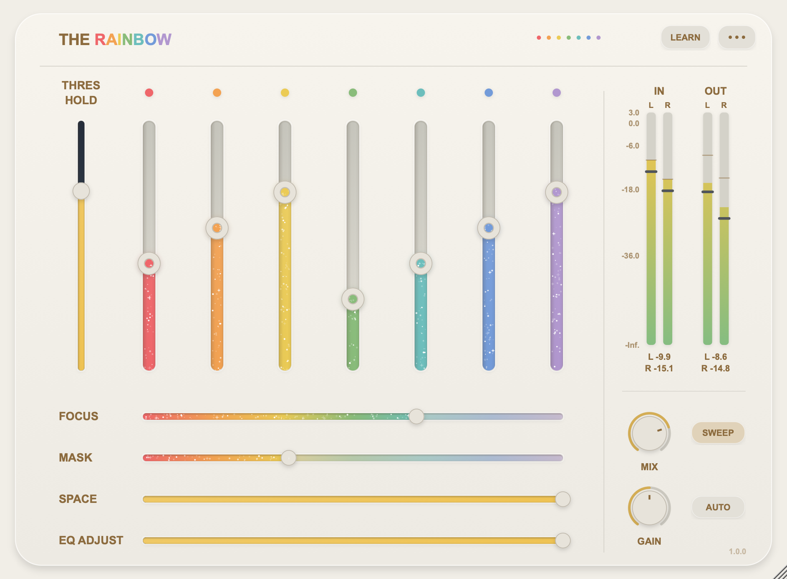
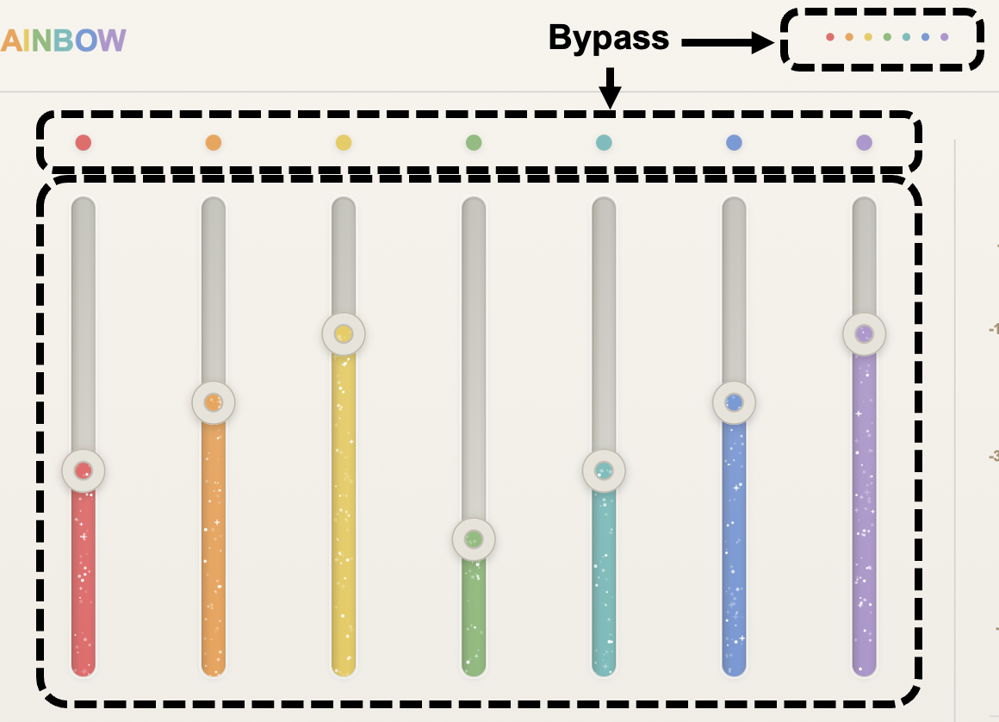
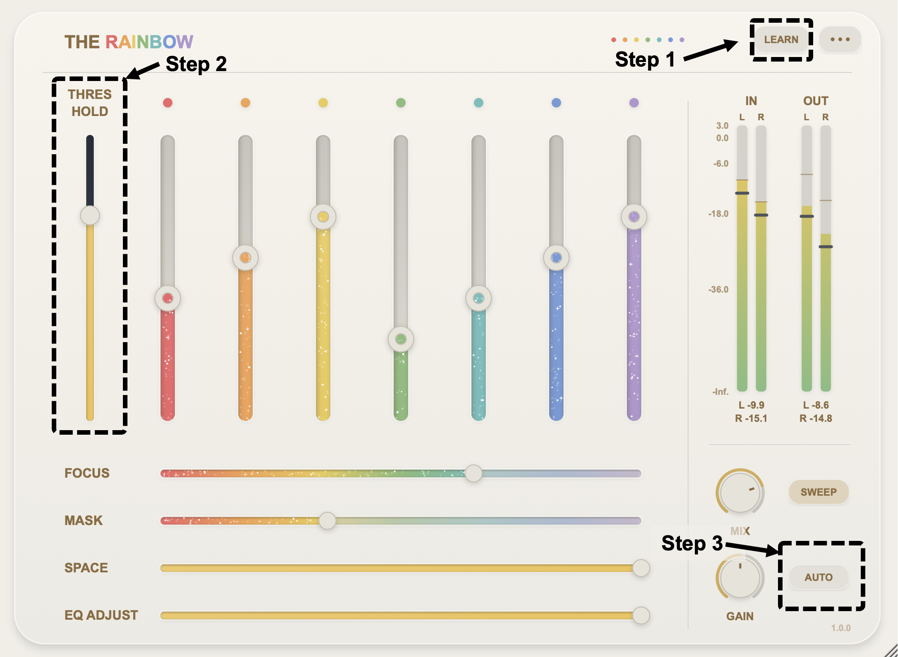
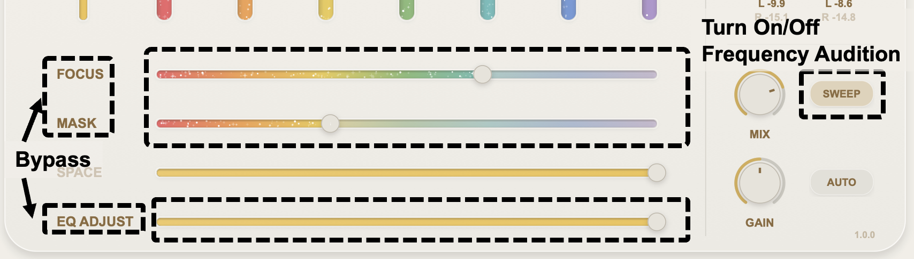
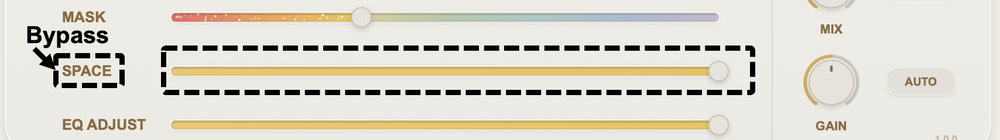
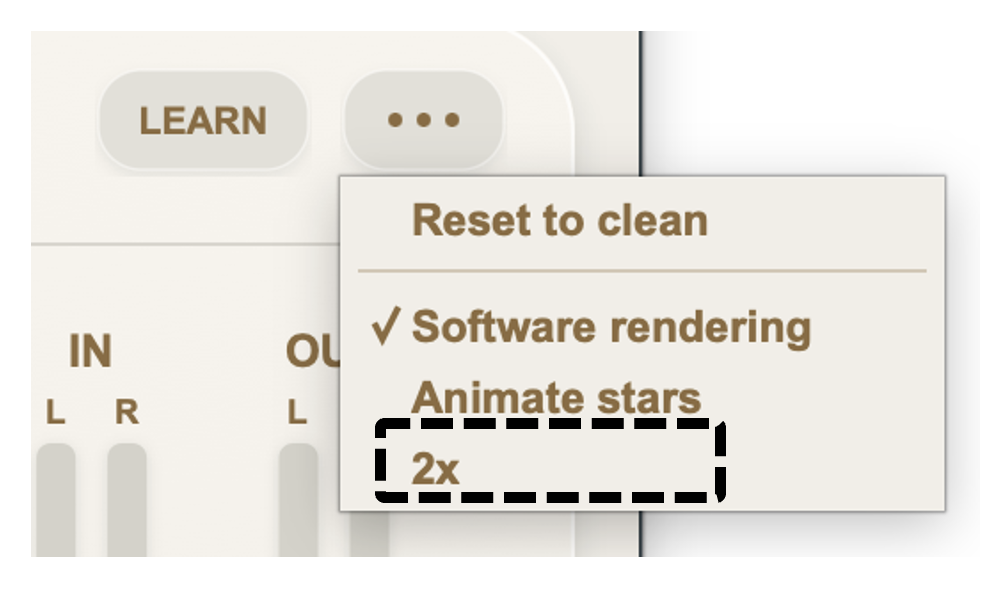

# The Rainbow 「彩虹」

[English](README.md) | [简体中文](README_zh.md)

一直以来，我都在思考混音的本质。混音的本质我认为是用直觉给音频素材套上一层情绪，这种情绪有多种色彩，但很少有音频插件将这种感性的情绪去做描绘。

Agent时代的到来，不禁让我思考混音是否已经到了门槛降低的时刻。将不同的情绪与混音几个最关键的要素相结合，让普通人也能够直接上手，让混音时能够快速找到对的处理，这一直以来是我努力的目标。

我将混音解构为四大核心要素：色彩，动态，详略，空间

我对回顾我所有过去的分轨工程，我将我几乎所有能够用到的处理链路归为七种色彩，将推子推上，就能获得好听的声音。每一种色彩都包含极其复杂的处理链路，甚至包括硬件建模的2A，3A，76以及其他压缩，使用复杂的路由以达到一个推子解决所有问题。可以使用不同的色彩比例来调节你认为最对的效果。同时如果你不确定这个色彩是否得当，你可以点击每种色彩上方的小圆按钮Bypass这一色彩。如果要整体Bypass所有色彩，可以点击插件上方七个小圆点。

同时插件设置了阈值设定以匹配不同素材的动态。你可以将播放这段素材电平最高的地方，按下LEARN按钮，插件就可以根据RMS自动调节阈值，当然你也可以手动调节阈值，来控制你想要的压缩量。强烈建议使用插件前开启自动增益功能，点击右下角AUTO便可开启自动增益，这会让你在同RMS下比较音频情绪的变化。

详略是这个插件最为核心的设置，你需要告诉插件我们应该关注什么，忽略什么。我设置了FOCUS和MASK两个频点调节功能，你可以拖动这两个推子来进行扫频，在你认为需要关注的频段以及需要放弃的频段停下，如果不需要，你可以点击前面的FOCUS和MASK关闭这个频点调节。同时，当你不需要扫频时，你可以点击右侧的SWEEP关闭扫频功能，或者可以使用鼠标滚轮对频点进行微调。如果你觉得EQ处理有点过头，你可以调节EQ ADJUST来调整EQ处理强度，同时也可以点击EQ ADJUST来Bypass所有的EQ处理。

除了红色，其他色彩均带有空间效果SPACE推子可以控制空间效果的比例，同样的，点击SPACE按钮可以Bypass所有空间处理。

同时，插件内置了干湿比调节功能，可以调节MIX旋钮调整插件处理强度。插件也具有增益功能，这一功能位于全部处理链的最后，可以调节GAIN旋钮放大音频电平。

插件支持2x高采样率功能，在右上角更多，点击2x便可开启。

我希望The Rainbow能够成为一款上手简单，声音好听，使用便捷，处理快速，界面好看，不需要经过太多思考便能够达到对应目的，给音频增加更多色彩的插件。这款插件将会保持永久免费，感谢您对The Rainbow这款插件的关注，同时感谢所有为音频事业付出的人们。

祝我们都能闪闪发光

[下载 The Rainbow v1.0.0](https://github.com/seacid/The-Rainbow/releases/tag/Rainbow)

[下载 The Rainbow v1.0.0（百度网盘）](https://pan.baidu.com/s/1lk3kobuN2XKKptza2CN2Mw?pwd=SASS)

